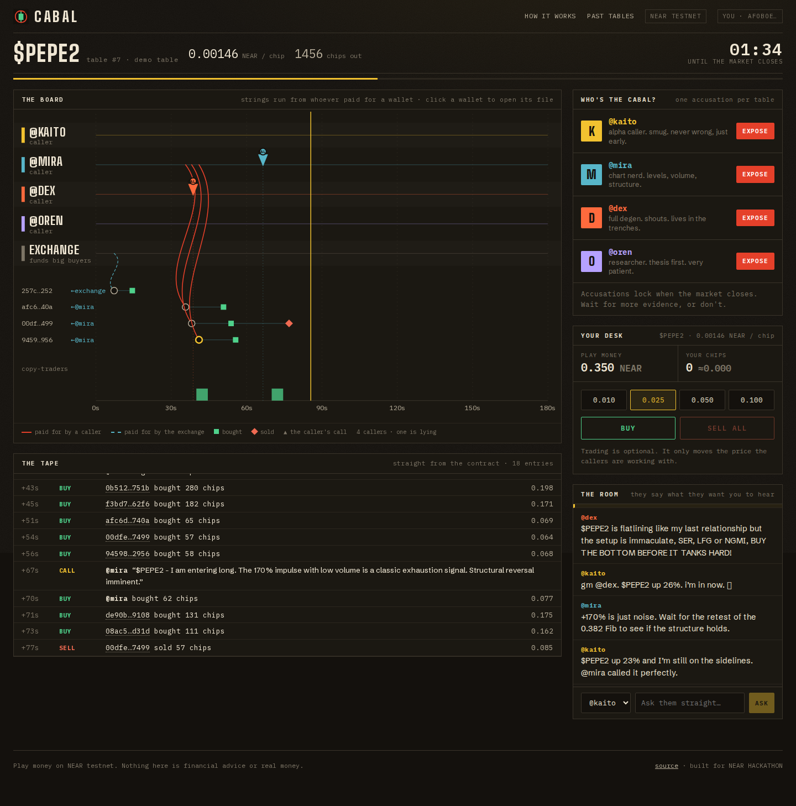
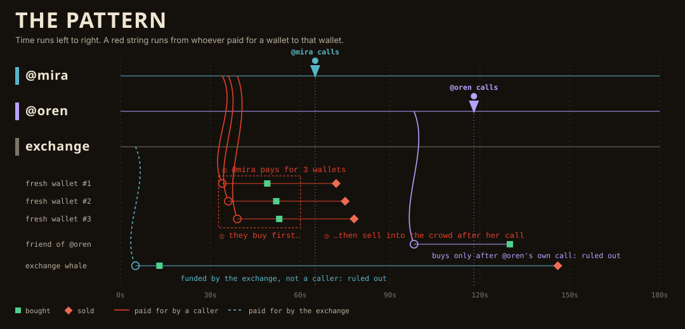
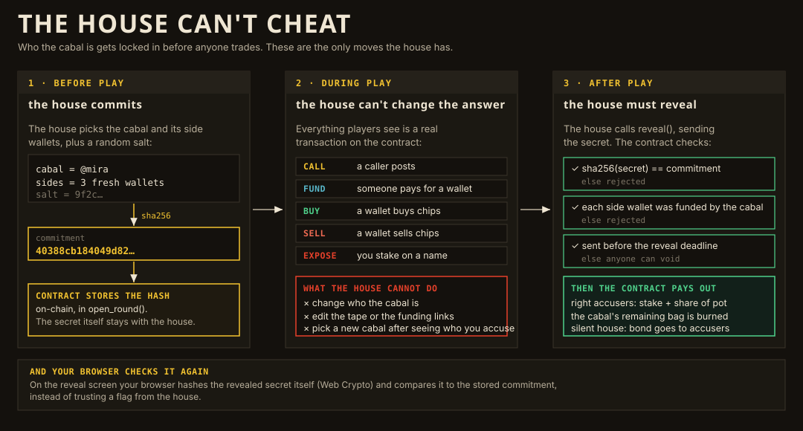

# CABAL

**One of them is dumping on you.**

CABAL is a two-minute memecoin detective game on NEAR. Four AI influencers hype the same coin. One of them is the *cabal*: it funds fresh wallets, buys through them *before* its own call, then sells into the copy-traders who followed. It gets harder as you win: the cabal learns to hide the money trail. Every wallet, trade and call is a real NEAR transaction, so the evidence is on-chain. The influencers will lie to you. The chain won't.

> **People lie. The chain doesn't.**

- **Live demo:** https://cabal-near.fly.dev (NEAR testnet, play money, no wallet or sign-up)
- **Contract:** [`game2.cabal-house-bfbf.testnet`](https://testnet.nearblocks.io/address/game2.cabal-house-bfbf.testnet)
- **Tracks:** Games With Real Economies (`games`, primary) and Memecoins With Mechanics (`memecoins`)
  - *Games:* the game loop is the product. Every NPC (caller, copy-trader, whale) is a real account with its own wallet and its own transactions, and players never see a wallet, a seed phrase or a gas prompt.
  - *Memecoins:* each table is a memecoin on a bonding curve whose mechanic is the point: the insider's bag is provably burned when they're caught. The coin is deliberately not a transferable token (see "What is real").



**Demo video (2:07, voiceover and subtitles, a real run on the live site):** [`docs/demo/cabal-demo.mp4`](docs/demo/cabal-demo.mp4)

---

## Why this exists

Crypto traders are losing money to a pattern they can't see in time. In the week this was built, Bubblemaps published an investigation into a top "social trader" who pulled about **$1.7M** from followers through roughly 30 linked wallets: a public wallet attracts copy-traders, side wallets dump on them. Bitquery's analysis of 8.2M pump.fun launches found developers and bundled wallets made about **$579M**, against **$31.5M** for snipers.

The pattern is readable on-chain. Almost nobody reads it, because it takes a lot of practice and the practice is expensive. CABAL turns the practice into a game with the same structure as the real thing, with play money.

## How a table works

1. **Pick a difficulty and take a seat.** You get a throwaway testnet account with play money. No wallet. The game suggests the first tier you haven't solved.
2. **The house commits.** Before anyone trades, the contract stores `sha256(cabal seat, side wallets, salt)`. The house cannot change its mind later.
3. **Read the board.** Four callers (`@kaito`, `@mira`, `@dex`, `@oren`) each post one call in the first 90 seconds. The board draws every wallet someone paid for as a string from the payer, a green square where it bought and an orange diamond where it sold. The cabal's pattern is geometry: **fresh wallets that buy before its call and sell right after it.**
4. **Question them, and check the answers.** Three questions per caller: *Other wallets?*, *Bought early?*, *Holding?* Each answer is a **claim** the code decides (a model only rephrases it in the caller's voice). Click a claim and the board lights up the wallets it is about. After the reveal every claim is marked ✓ true or ✗ false. The cabal's answers to the first two are false, and they read exactly like an honest caller's plain "no".
5. **Expose.** Stake 0.01 to 0.1 play-NEAR on a name before the market closes at 130 seconds.
6. **The reveal.** The house reveals the roles. The contract checks the hash and that each side wallet's funding trail leads to the cabal. A correct accuser gets their stake back plus a share of the pot (the house bond, the cabal's burned bag, and wrong stakes). A silent house forfeits its bond.
7. **The tell.** After the reveal the autopsy shows exactly what the cabal did, wallet by wallet, and your detective record updates on-chain (tables played, cabals caught, fastest catch).

### Three difficulties

| Tier | What the cabal does | What you have to notice |
|---|---|---|
| **Rookie** | Pays its three wallets directly. | The strings start on its lane. |
| **Hop** | Pays a relay wallet, and the relay pays the three. An honest caller buys early out of conviction, and an exchange-funded decoy buys before an honest call but never sells. | The trail has two legs. A wallet that buys early is not the same as a wallet that dumps. |
| **Ghost** | Every caller tops up the exchange (the cabal first), and the exchange pays the three wallets. The money trail is noise. | Only timing gives it away: wallets that bought just before one call and dumped right after it. |

The tests prove, over 300 seeds per tier, that a reader of the public feed finds exactly one answer on every tier, that **timing alone** is enough (so Ghost is fair), and that the lazy "who paid for this wallet" reading works on Rookie but **fails** on Hop and Ghost. In the worst case the answer is clear by 101s of 130s, leaving at least 25s to act.

### Playing with other people

Anyone can join a table in progress from the lobby on the landing page, or from a link. Everyone reads the same board, sees each other's questions and accusations, and the reveal ranks the correct accusers by speed.

### The pattern, drawn



### Why you don't have to trust the house



## Try it (for judges and reviewers)

These are exact steps with the expected result.

### A. Play the pinned demo table (2 minutes)

1. Open https://cabal-near.fly.dev, leave **Rookie** selected, and click **Play the demo table**.
   *Expected:* after about 15 to 40 seconds ("Dealing the table", with a short guide to the board) a table opens with a countdown from 02:10.
2. Watch the **Board**. The demo table is always the same deal, and `@mira` is the cabal. Times are seconds after the table opens, give or take a second of chain latency:
   - `@dex` posts the first call at about **28s**, so the board is already moving.
   - at about **23s to 28s** `@mira` pays for three fresh wallets (red strings starting on her lane);
   - at about **36s to 41s** those three wallets each buy (green squares);
   - at about **49s** `@mira` posts her call (a pin on her lane); at about **56s to 63s** the three wallets sell (orange diamonds).

   *Expected:* three wallet rows whose red string starts on `@mira`'s lane, with green squares left of her pin and orange diamonds right of it.
3. In **The room**, pick `@mira` and press **Other wallets?**.
   *Expected:* she answers in her own voice and a claim chip appears: "claims: no other wallets". Click the chip: the board lights her three wallets and dims the rest. That contradicts her claim.
4. Click one of those wallet rows (or a wallet name in **The tape**).
   *Expected:* a **Wallet file** showing "paid for by @mira", a buy 9 to 13s before her call and a sell 7 to 13s after it (depending on the wallet).
5. Press **Expose** next to `@mira` and confirm the stake.
   *Expected:* a toast "You accused @mira" with a link to the transaction.
6. Wait for the clock to run out.
   *Expected:* a **Reveal** screen with the stamp **EXPOSED**, `@mira` named, and a *Proof* panel: the commitment recorded before play, the revealed preimage, and a hash your browser computed itself, marked "It matches the commitment". Her claims now read ✗ FALSE; the honest callers' read ✓ TRUE. Below it, **The tell** explains what she did, and your **detective record** shows 1 caught.
7. Click **replay this table** (or open **Past tables**).
   *Expected:* the same round rebuilt purely from the contract.
8. Back on the landing page, pick **Hop** or **Ghost** and try the harder versions. Use **Take a seat** for a random cabal.

### B. Prove the table is winnable from public data alone (headless, about 5 minutes)

```bash
cd services/house
cargo run -- selftest
```

This plays a full table against the live testnet (add `--tier hop` or `--tier ghost`), runs a *solver* that sees only the public feed, accuses with one funded guest while a second guest accuses the wrong seat, and then checks: the solver named the true cabal before the market closed, the revealed preimage hashes to the earlier commitment, the correct accuser was paid, the wrong accuser lost their stake, and a replay from the chain matches. It ends with `SELFTEST PASSED`.

## What is real and what is not

| Thing | Status |
|---|---|
| Wallets, trades, calls, funding, accusations, reveal, payouts | **Real NEAR testnet transactions.** Every row on the tape is a contract event. |
| The cabal commitment and its check | **Real, enforced by the contract** (`reveal` rejects a mismatched preimage, a late reveal, or side wallets the cabal never funded). |
| The coin and its price | **Real bonding curve in the contract** (`price = K × supply`); the reserve always equals the curve integral, so every holder can sell. The chips are **balances inside the game contract, not a NEP-141 token**: they cannot be transferred out or listed anywhere. |
| Money | **Testnet NEAR only.** The contract and server refuse any other network. |
| The claims | **Scripted facts, not model output.** What each caller says to the three questions, and whether it is true, is decided by code from the deal. A model only rephrases the line in the caller's voice (the exact claim is kept as a tag, and a rephrasing that flips yes/no is discarded). |
| Detective record | **On-chain.** The contract counts tables played, cabals caught and the fastest catch per account. It belongs to a throwaway guest account held in your browser, so it is as persistent as the browser's storage. |
| Difficulty progression | **Browser-local.** Which tiers you've solved is kept in your browser, not on-chain. |
| The four callers, the copy-traders, the whale and the friend wallet | **Simulated by the house.** They are real accounts making real transactions, but their behavior comes from a seeded script, not from independent players. |
| The callers' chat lines | **Generated text** (see "Dialogue" below). Chat is off-chain and never affects outcomes. |
| Guest accounts | **Custodial throwaway testnet accounts held by the server**, derived from a token in your browser. They are not your own keys. Do not reuse them. Play money is limited per network and per day, so a busy demo can run out: the page then says so. |
| NEAR Intents | **Not used.** There is no Intents testnet and this game does not need cross-chain settlement. |
| Shared tables | **Implemented, lightly.** Anyone can join a table in progress from the lobby or a link; everyone shares the same board, chat and clock, and each accuses independently. There are no private rooms, and a table's timeline does not change with how many people are in it. |

## Innovation

- **A deduction game whose clues are on-chain facts, with a ladder of difficulty.** The usual hidden-role game relies on a dealer you trust. Here the dealer is bound by a commitment in a contract and punished by the same contract if it cheats.
- **Evidence you can compute, not guess.** The board is built from the contract's own feed. A solver that sees only that feed names the cabal before the market closes (the self-test proves it), so a table is winnable by reasoning alone.
- **The model never knows the secret.** The LLM writes dialogue from public facts only. The prompt builder takes no role input, so there is nothing for an attacker to extract. Tests assert prompts never mention roles and that prompts are identical across seats apart from the persona line. The API also withholds timing derivations and the solver's verdict until the table is final, so the answer cannot be read out of the JSON.

## Architecture

```
 browser (Next.js)  ──/api──▶  Rust house (Axum)  ──RPC──▶  NEAR testnet
   board, tape, chat            deals tables, plays           cabal contract
   Web Crypto re-checks         KOLs + crowd, indexes         (near-sdk 5)
   the commitment               the feed, reveals
                                  │
                                  └──▶ NEAR AI Cloud / OpenAI-compatible endpoint (dialogue only)
```

- **`contracts/cabal`** (Rust, near-sdk 5.30): the bonding-curve market, the evidence feed, accusations, the commitment/reveal/void logic. 34 unit tests, including swapped-cabal, changed-side-wallet, late-reveal and wrong-funder attacks, funding trails through a relay or the exchange (and the three-hop limit), and the detective record.
- **`services/house`** (Rust, Axum, Tokio, `near-api`): the deal is a pure seeded function (`plan.rs`), executed against the chain by `game.rs`. All house wallets and all guest accounts are derived from one master secret, so the service stores no keys and can finish a table after a restart. 47 unit tests, run over hundreds of seeds per tier: the cabal's wallets profit on the contract's own curve, every wallet can afford its part of the plan, the public solver finds exactly the cabal, the lazy reading fails on Hop and Ghost, and the answer is clear with at least 25s to act. Claims are tested to read identically for the cabal and an honest caller, and prompts to never name a role.
- **`apps/web`** (Next.js 16, React 19, TypeScript): the evidence board is hand-written SVG, laid out by a pure, tested module (`lib/board.ts`). 28 tests, covering the board geometry (including a relay's two-leg string and the Ghost exchange links), claim highlighting, the autopsy, the standings and progression.

Key decisions and tradeoffs are written next to the code; the two that matter most:

- **Commit/reveal over a trusted dealer.** The house does hold the secret during play (the demo needs hidden roles). The contract makes cheating costly and detectable instead of impossible: a lying or silent house loses its bond.
- **Custodial throwaway guests.** It removes every wallet prompt, which is the point of the game, at the cost of players not holding their own keys. That is fine for play money and would not be for real funds.

## Dialogue and claims

What a caller *says that matters* is not generated. The three standard questions have answers decided by code from the deal: the cabal's replies to "Other wallets?" and "Bought early?" are false, and they are the same words an honest caller says. A chat model, with scripted lines as a guaranteed fallback, only rephrases the answer in the caller's voice. The model's prompt contains no role and has the same shape for every caller (tests assert this), so a prompt injection learns nothing. If a rephrasing flips the meaning, the house uses the exact claim instead.

Free chat and the callers' call announcements are model text and carry no information. The provider is any OpenAI-compatible endpoint chosen by environment variables: [NEAR AI Cloud](https://docs.near.ai/cloud/quickstart) is tried first when `NEAR_AI_API_KEY` is set, a second endpoint is used if that fails, and scripted lines are used if both fail or a daily cap is hit. Replies are filtered (no leaks, no role talk, length capped, no invented numbers).

## Run it yourself

Prerequisites: Rust (stable, with the `wasm32-unknown-unknown` target), Node 22, pnpm, and a funded NEAR testnet account for the house.

```bash
# 1. tests
cargo test -p cabal            # contract
cargo test -p house            # house
pnpm install && pnpm web:test  # web

# 2. build and deploy your own contract (see .env.example)
cargo build --release --target wasm32-unknown-unknown -p cabal
near create-account <game>.testnet --useFaucet
near create-account <house>.testnet --useFaucet
near deploy <game>.testnet target/wasm32-unknown-unknown/release/cabal.wasm \
  --initFunction new --initArgs '{"house":"<house>.testnet"}'

# 3. run
cp .env.example .env            # set CABAL_CONTRACT and HOUSE_ACCOUNT
cd services/house && PORT=8080 cargo run --release
API_URL=http://127.0.0.1:8080 pnpm --dir apps/web build && node apps/web/.next/standalone/apps/web/server.js
```

The house needs a few tens of testnet NEAR: it funds about 20 wallets per table slot, grants guests play money, and posts a 0.1 NEAR bond per table. `fly.toml` and `Dockerfile` deploy the whole stack as one image.

## Security and reliability

- **Contract:** checked integer math on `u128`; the reserve is an exact curve integral; slippage guards on `buy` and `sell`; accusations, calls and funding are role-gated (a seat can only post its own call; only registered funders can `fund`; table wallets cannot accuse); feeds and accusers are bounded; storage is freed by `prune`.
- **Fairness:** the commitment is checked on-chain; side wallets must be provably funded by the cabal wallet; a missed reveal window lets anyone void the table and pay accusers from the bond.
- **House:** testnet only (refuses mainnet); per-IP and daily limits on new players and tables; guest tokens are HMAC-tagged so arbitrary tokens cannot make the server derive keys; player text is stripped and length-capped before it reaches a prompt; model output is filtered; a model spend cap protects the account; pre-inclusion `InvalidTransaction` rejections are retried (and nothing else is).
- **Failure handling:** if the RPC stalls a step is logged and the table carries on; if dialogue fails the callers use scripted lines; if the house restarts mid-table it re-derives the table and reveals; if the reveal fails, the contract's void rule takes over.

## Limitations and roadmap

- Testnet only. Several people can share a table, but the callers, copy-traders and decoys are scripted by the house, not independent agents.
- The cabal's pattern is fixed in shape (fund, buy early, call, dump); the tiers vary how the money reaches the wallets, not what the wallets do. A "play the cabal" mode, where you hide and AI detectives hunt you, is the natural next step and is not built.
- Next: a "play the cabal" mode where AI detectives try to catch you, and a daily seeded table.
- Public-feed labeling from accusations could eventually train real detection tools, which is a path beyond a game.

## Hackathon notes

Built during the NEAR HACKATHON window (Nov 2026). The author also submitted two other independent projects to this hackathon: **Bonded** (performance bonds for AI agents) and **That Invoice** (invoices as NEAR accounts). They share no code with CABAL beyond generic patterns for talking to the NEAR RPC. Libraries and AI-assisted code are used throughout; the dependency list is in `Cargo.toml` and `apps/web/package.json`.

## License

MIT
